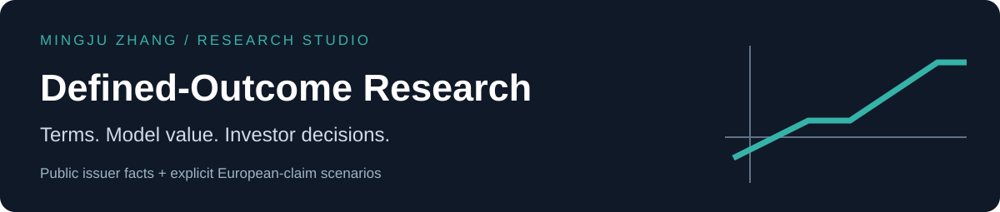
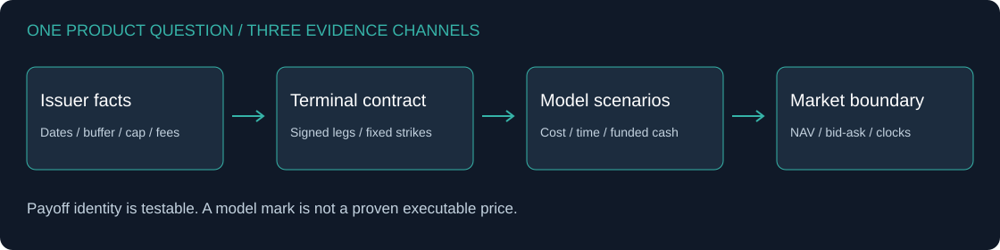

# Defined-Outcome Research

**How do a buffer, an upside cap and a purchase date combine into an investor's actual payoff?**

I rebuilt the product logic from dated public issuer materials, then implemented a small European-claim scenario engine. The study connects contractual payoff, option cost, remaining time, fees and a funded investor account. It provides three explicitly different evidence channels: **issuer terms**, **model marks** and **market observations**.

[](https://github.com/Mingju-Zhang-CBS/defined-outcome-research/actions/workflows/tests.yml)

[Results](reports/demo/REPORT.md) · [Worked example](docs/WALKTHROUGH.md) · [Methods](docs/METHODS.md) · [Sources](docs/PROVENANCE.md) · [Research directory](https://github.com/Mingju-Zhang-CBS/Quant)

## Start with the distinction

| Object | What it answers | Evidence here |
|---|---|---|
| Terminal target | What shape is sought over the original outcome period? | BJAN/FJAN public terms and a normalized piecewise contract |
| Interim model value | What is a claim worth under declared assumptions today? | Analytical European option marks with explicit cost and fee conventions |
| Actual NAV / bid-ask | What was observed for a real ETF share at a particular time? | Separate validated input channel; **zero observations bundled, no NAV reconciliation** |

The default run is fully offline. Real issuer facts identify the case; simulated inputs produce all valuation and return scenarios. No product return backtest, trade fill or real-world performance is claimed.

## What the research finds


- **An original 9% buffer does not define a later buyer's loss.** At six months elapsed, reference 120 and 20% volatility, model entry cost is 110.8800. After the declared remaining-period fee, maximum terminal return is 4.62%; return if the reference ends at its original 100 is -10.17%.
- **Payoff and funding cost are separate.** The BJAN-shaped strip costs 99.8978 under the base model, rather than an assumed 100. A protective put costs 106.4580. Returns divide by the cost actually modeled.
- **Fee definitions matter.** The issuer-published gross/net cap is 16.46%/15.67%. A distinct proportional-unit fee illustration on a hypothetical 100 entry gives 15.54%; this is not an ETF NAV forecast or a correction to the issuer.
- **Small budgets can be infeasible.** A multiplier-100 package costs $10,003.77 after the declared 10-bp entry half-spread and $4 commission. Both $5,000 and $10,000 budgets buy zero packages; residual cash remains in the account.

All 36 predeclared entry states, nine fee/friction cases, nine model budget-cap cases and five figures remain visible in the [full report](reports/demo/REPORT.md). The grid includes counterfactual stress states, not a historical price path.

## Research design and implementation



The primary case uses BJAN's January-December 2026 period, a 9% gross buffer and 16.46% gross cap. FJAN supplies a separately dated terms cross-check. Sources are the [BJAN prospectus](https://www.innovatoretfs.com/pdf/bjan_summary_prospectus.pdf), [BJAN factsheet](https://www.innovatoretfs.com/pdf/bjan_factsheet.pdf) and [FJAN issuer page](https://www.ftportfolios.com/Retail/Etf/EtfSummary.aspx?Ticker=FJAN), frozen as factual extracts with dates and hashes. Source documents and market feeds are not redistributed.

I implemented signed price-claim/option legs, boundary-safe analytical values, entry-adjusted terminal returns, a model budget-balanced cap solver, fee/friction sensitivity and integer package settlement. A separate CSV validator rejects ambiguous quote units, missing time zones, future observations and crossed bid/ask. It never treats a displayed midpoint as a proven fill.

**Skills demonstrated:** mathematical finance and numerical validation; product-term interpretation; scenario design; funded portfolio accounting; data provenance; communicating the difference between a model and an investment decision.

## Reproduce in Python 3.12

```bash
python -m venv .venv
# Activate .venv for your operating system.
python -m pip install -r requirements.lock.txt
python -m pip install --no-deps -e .
python -m pip check
python -m pytest
python -m defined_outcome_research --demo --output local-runs/demo
python examples/explain_entry.py
```

Use a new output folder for each run; existing results are not overwritten. No API key, GPU, paid model or company service is needed. The wheel includes the same protocol and facts, so the study also runs outside the source tree.

Tests cover independent risk-neutral integration, put-call parity, strike boundaries, fee compounding, funded costs, integer cash conservation and quote failures. CI executes the tests, complete study and worked example. [protocol.json](protocol.json) fixes inputs; [manifest.json](reports/demo/manifest.json) binds results to source, data and environment hashes. Runtime and Python allocation peaks are local measurements, not trading-system benchmarks.

## Read further

- [Methods](docs/METHODS.md): formulas, dividends, fee conventions, budget and quote boundaries.
- [Walkthrough](docs/WALKTHROUGH.md): one purchase through settlement and an issuer-versus-model checklist.
- [Interview guide](docs/INTERVIEW.md) and [resume wording](docs/RESUME.md): explainable claims with linked evidence.
- [Source ledger](defined_outcome_research/data/issuer_terms.json) and [data notice](DATA_LICENSE.md): dated minimal facts and rights scope.

## Limits and contribution

All model rates, volatilities, dividends and spread assumptions are illustrative. The actual fund's holdings, quantities, cash, accrued fees, volatility surface and trading frictions are not reconciled. A positive-strike deep call is not a zero-strike underlying claim. No model value is presented as a quote; no issuer cap mispricing is inferred. Broker margin and legging risk may prevent a theoretical package from being traded.

This independent implementation by Mingju Zhang was developed with AI assistance. Standard public pricing methods and third-party libraries retain attribution. Employer workbooks, client scenarios, restricted data and prior internship figures are excluded. Newly authored code and figures are MIT-licensed; issuer materials and trademarks retain their own rights.

[Derivatives Pricing Lab](https://github.com/Mingju-Zhang-CBS/derivatives-pricing-lab) · [Systematic Strategy Lab](https://github.com/Mingju-Zhang-CBS/systematic-strategy-lab) · [Profile](https://github.com/Mingju-Zhang-CBS)
