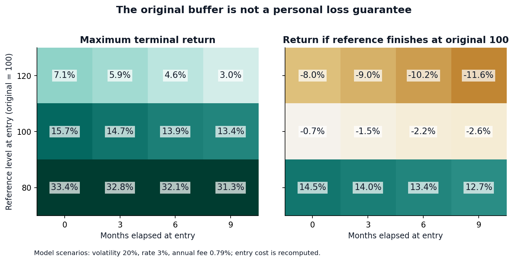

# Defined-Outcome Research

What does buying a buffered ETF after the outcome period begins do to the buyer's payoff? I use dated public BJAN and FJAN issuer terms and a funded European-option scenario model to study entry price, remaining time, fees and option costs.

**Finding.** In the BJAN-shaped example, at six months elapsed, an underlying reference level of 120 and 20% volatility, the modeled entry cost is **110.8800**. After the assumed remaining-period fee, the maximum terminal return is **4.62%**. If the reference ends at its original 100, the modeled investor return is **−10.17%**, despite the original 9% gross buffer.

[Scenario results](reports/demo/REPORT.md) · [Methods](docs/METHODS.md) · [Run the study](#run-the-study)



*Deterministic European-option scenarios using issuer-published product terms and illustrative market inputs. Returns use each scenario's modeled purchase cost. The figure contains no real fund NAV or quote observations.*

## Terms, value and observations

- **Issuer terms.** The BJAN January–December 2026 case has a published 9% gross buffer and 16.46% gross cap. The [source ledger](defined_outcome_research/data/issuer_terms.json) identifies the dated terms and the separate FJAN cross-check.
- **Terminal payoff and interim value.** The normalized option legs determine contractual shape. A buyer's cost, fee convention and remaining term determine modeled returns. The [worked purchase](docs/WALKTHROUGH.md) follows the investor account through settlement.
- **Market observations.** A separate validator checks the time and units of user-supplied NAVs or quotes. The public run supplies zero observations on this path. Its model marks and integer-package scenarios do not establish actual fund performance or fill prices.

The full report also preserves all 36 entry states and the fee, friction and option-budget sensitivities. [Fee and option budget](reports/demo/fees_and_option_budget.png) · [Integer package funding](reports/demo/integer_budget.png)

## Run the study

Use Python 3.12 from the repository root. Activate the virtual environment with `.venv\Scripts\Activate.ps1` in PowerShell or `source .venv/bin/activate` on macOS/Linux.

```bash
python -m venv .venv
# Activate the environment before installing.
python -m pip install -r requirements.lock.txt
python -m pip install --no-deps -e .
python -m pip check
python -m pytest -q tests
python -m defined_outcome_research --demo --output local-runs/demo
```

The demo runs offline after installation. Use a fresh output directory. The [protocol](protocol.json) fixes the inputs, and the [manifest](reports/demo/manifest.json) records the sources and outputs. The tests cover pricing, fee compounding, funded costs and quote validation.

[Attribution and AI assistance](docs/PROVENANCE.md) · [Data license](DATA_LICENSE.md) · [Technical discussion](docs/DISCUSSION.md) · [Research directory](https://github.com/Mingju-Zhang-CBS/Quant)
