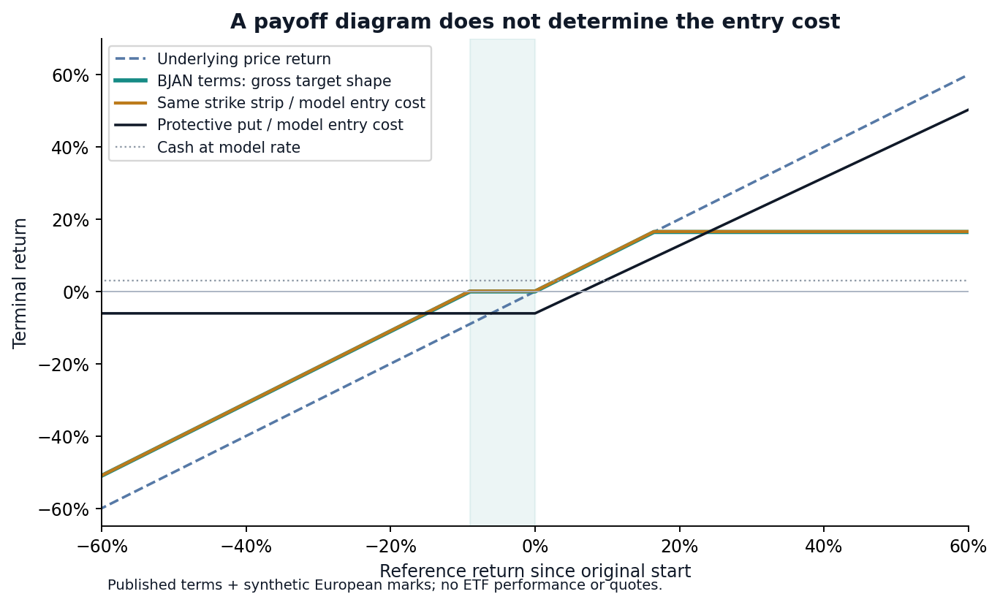
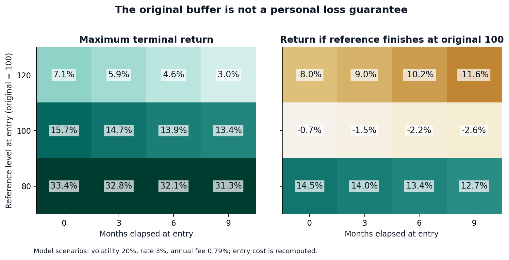
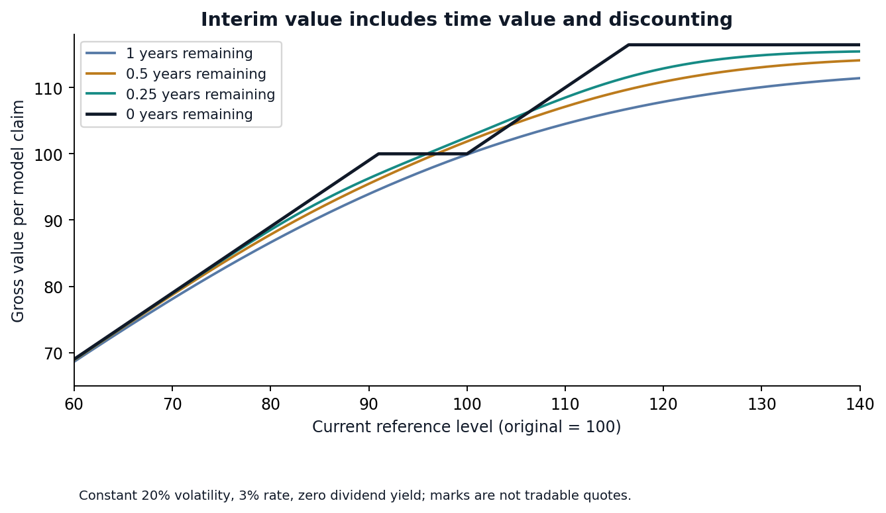
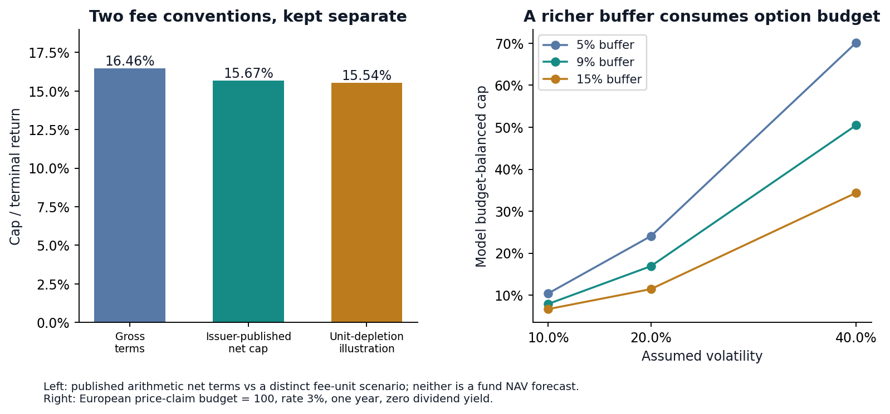
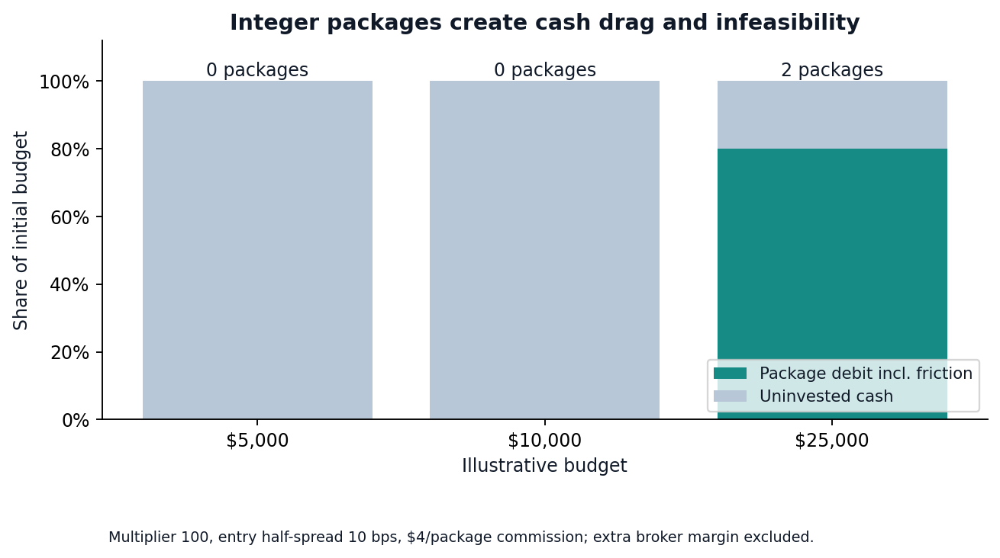

# Defined-Outcome Research | Results

**Evidence:** issuer-published factual terms, followed by synthetic, deterministic European-claim scenarios. No fund-performance backtest or executable quote comparison. Configuration: [protocol](../../protocol.json); exact figures and environment: [metrics](metrics.json) and [manifest](manifest.json).

## 1. Terms before modeling

| Case | Outcome period | Gross cap / buffer | Published net cap / buffer | Annual fee |
|---|---|---|---|---|
| BJAN | 2026-01-01 to 2026-12-31 | 16.46% / 9.00% | 15.67% / 8.21% | 0.79% |
| FJAN | 2026-01-20 to 2027-01-15 | 14.53% / 10.00% | 13.68% / 9.15% | 0.85% |

Sources: [BJAN summary prospectus, February 27, 2026](https://www.innovatoretfs.com/pdf/bjan_summary_prospectus.pdf), [BJAN factsheet, June 30, 2026](https://www.innovatoretfs.com/pdf/bjan_factsheet.pdf), [FJAN issuer snapshot, retrieved October 23, 2026](https://www.ftportfolios.com/Retail/Etf/EtfSummary.aspx?Ticker=FJAN). FJAN is a terms cross-check, not a performance comparison; its dates and buffer differ. Published net figures exclude some investor costs and are not promised realized returns. Source hashes and locators are in the [fact ledger](../../defined_outcome_research/data/issuer_terms.json).

## 2. The cost of the payoff

The BJAN-shaped stylized strip costs **99.897781**, versus reference 100, under 3% rate, 20% volatility, zero dividend yield and one year. A gross payoff plateau at 100 therefore does not imply a zero return on that model purchase. The price-only claim costs 100.000000; the protective put costs 106.457957. Cash grows at the declared 3% continuous rate. Compare full costs in [initial_costs.csv](initial_costs.csv).

The direct piecewise target and independent signed-leg payoff agree to **1.11e-16** return units on 322 grid points including strikes. This validates the mathematical identity, not a fund replication. The factsheet's deep call has a positive strike of 1.0016% of the starting reference; replacing it with a zero-strike price claim changes the terminal economics. Rounded strikes imply buffer 8.999457% and cap 16.467966%. Fund quantities, cash, accrued fees and contract details are not reconciled, so no issuer NAV or cap-pricing error is claimed.

## 3. A later buyer gets a different payoff relative to cost

At six months elapsed, reference 120 and volatility 20%, the gross model entry value is **110.880029**. With 0.79% annual proportional-unit fees for the remaining half-year, the maximum terminal return is **4.62%**. If the reference finishes at its original 100, this buyer loses **10.17%**. The 9% original buffer is not measured from this buyer's entry price. All 36 predeclared combinations remain in [entry_scenarios.csv](entry_scenarios.csv); the example is explanatory, not a selected trading rule. At elapsed zero, spot 80/120 are instantaneous stress states after fixing the reference at 100, not alternative actual inception observations.

## 4. Interim value is a model mark

The payoff is piecewise only at expiry. Before expiry, option time value, discounting and volatility smooth the shape. This study does not imply that these marks are the ETF's NAV, a dealer's price, or an executable option quote. Dividend yield discounts the claim paying only S_T; actual stock holdings would also have dividend cash flows. Constant parameters, European exercise and frictionless pricing omit skew, smile, liquidity and fund operations.

## 5. Fees and the option budget

The issuer publishes 16.46% gross and 15.67% net cap. A separate unit-depletion scenario gives **15.5436%** on a hypothetical 100 entry and gross terminal wealth 116.46. Subtracting an annual percentage of initial capital and charging a proportional NAV fee are different calculations. The latter is not a reconstruction of actual ETF accounting. On the actually priced strip, returns divide by 99.897781, not by 100; see [fee_friction.csv](fee_friction.csv).

Solving a model budget of 100 gives cap **16.9076%** for a 9% buffer at 20% volatility. This is a model counterfactual under fixed assumptions, not a fair-value verdict on the issuer's cap. [Nine fixed buffer/volatility cases](model_budget_caps.csv) retain infeasible roots if any; cap is not chosen to maximize a historical return.

## 6. Integer packages and settlement

The package multiplier is 100; entry half-spread is an assumed 10 bps and commission $4 per package. A $5,000 budget buys zero packages. [integer_accounts.csv](integer_accounts.csv) records residual cash, funded debit and settlement at reference 80; the unspent cash earns the model cash rate. Full package debit is reserved and exact netting is assumed; broker margin, short-leg approval and legging risk could make a theoretical package unavailable.

## 7. Quote channel and decision boundary

**Bundled quote observations: 0. Actual fund NAV reconciliation: not performed.** Public issuer pages display NAV and delayed market fields with different clocks. No synchronized licensed quote snapshot is included or fabricated. The empty [quote schema](../../examples/quotes.schema.csv) accepts separately typed, timezone-aware NAV or bid/ask observations. Its audit never labels a displayed quote as a proven fill. ETF-share dollars cannot be compared directly with a normalized option claim; conversion requires verified holdings, quantities, cash and matched times.

The useful result is a decision checklist: identify the original outcome reference, pay the actual entry cost, distinguish fee conventions, preserve the cash account, and verify real market data before discussing a trade. This study does not rank ETFs or claim achievable investment returns.

[Methods](../../docs/METHODS.md) · [Worked example](../../docs/WALKTHROUGH.md) · [Sources and contribution](../../docs/PROVENANCE.md) · [Research directory](https://github.com/Mingju-Zhang-CBS/Quant)
